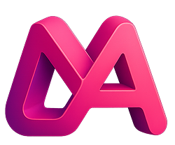

<!-- TOP ACCENT: RETRO-CYBER MAGENTA TO CYAN WAVE -->
<div align="center">
  
</div>

<!-- HERO SECTION: LOGO + IDENTITY + TYPING TERMINAL -->
<div align="center">
  
  <br />
  <br />
  
  <br />
  
</div>

<br />

<div align="center">
  <a href="https://contra.com/muhammad_aswin_sigit_jk8xiulv"></a>
  &nbsp;
  <a href="https://www.linkedin.com/in/muhammad-aswin-sigit-2a58881a1"></a>
  &nbsp;
  <a href="mailto:mhmmdsgt29@gmail.com"></a>
  &nbsp;
  <a href="https://iqroomkedinasan.com"></a>
</div>

<br />

---

### `01. SYSTEM_PROFILE`

```yaml
IDENTITY:
  name       : "Muhammad Aswin Sigit, S.Kom."
  degree     : "B.Sc. in Computer Systems Engineering — Universitas Tanjungpura"
  base       : "Pontianak, Kalimantan Barat, Indonesia (UTC+7)"
  work_mode  : "Remote / Hybrid / On-Site"

PRIMARY_DIRECTIVES:
  - "End-to-End Product Ownership: Figma Design System -> Clean Code -> Cloud VPS Deployment"
  - "High-Concurrency Architecture: Real-Time WebSockets, Redis Caching & Modular REST APIs"
  - "Security & Performance: Multi-Tier RBAC, DRM Content Protection, Server Hardening"
```

Results-driven **Full-Stack Developer & UI/UX Designer** with a proven track record of architecting and shipping enterprise-scale web platforms from scratch. Bridging modern **React 19 + TypeScript** and **Vue.js** front-end ecosystems with resilient **Laravel**, **PostgreSQL/MySQL**, and **Redis** backends, deployed on self-managed **Linux Cloud VPS** infrastructure.

---

### `02. DEPLOYED_PRODUCTION_SYSTEMS`

<table>
  <tr>
    <td width="50%" valign="top">
      <a href="https://iqroomkedinasan.com">
        
      </a>
      <h4>◈ IQ ROOM KEDINASAN — EdTech, LMS & CBT Platform</h4>
      <p>
        <a href="https://iqroomkedinasan.com"><code>LIVE: iqroomkedinasan.com</code></a> &nbsp;|&nbsp; <code>Jul 2025 – Present</code>
      </p>
      <p>
        Full custom enterprise ecosystem engineered solo from UI/UX to production Cloud VPS.
      </p>
      <ul>
        <li><b>Modular Scale:</b> 11 business domains, 92 relational migrations, 425+ web/API routes, and 840+ React 19 + TypeScript modules (Light/Dark Mode).</li>
        <li><b>Real-Time Anti-Cheat CBT:</b> Server-authoritative timer, KaTeX math rendering, Redis non-blocking autosave, tab-lock auto-submit, and live WebSocket proctoring (Laravel Reverb).</li>
        <li><b>E-Rapor & Binjas Engine:</b> Automated weighted grading (Academic 50%, Physical/Binjas 35%, QR Attendance 15%) with <b>SHA-256 Digital Sealing</b> & public QR verification.</li>
        <li><b>DRM & Monetization:</b> Canvas-rendered anti-download PDF viewer (Nginx <code>X-Accel-Redirect</code>), Midtrans Snap (SHA-512 Webhook), and integrated Affiliate Wallet.</li>
        <li><b>Extreme Optimization:</b> Migrated to Ubuntu 24.04 Cloud VPS + Cloudflare WAF with 0% data loss; reduced 240+ math-question PDF export from <b>&gt;112s timeout to ~2.3s (~98% faster)</b>.</li>
      </ul>
      <p>
        <code>React 19</code> <code>TypeScript</code> <code>Laravel 13</code> <code>Inertia.js</code> <code>Tailwind v4</code> <code>Redis 7</code> <code>Reverb</code> <code>Ubuntu VPS</code>
      </p>
    </td>
    <td width="50%" valign="top">
      <a href="https://balaibahasakalbar.kemendikdasmen.go.id">
        
      </a>
      <h4>◈ BALAI BAHASA KALBAR — Official Government Portal</h4>
      <p>
        <a href="https://balaibahasakalbar.kemendikdasmen.go.id"><code>LIVE: balaibahasakalbar.kemendikdasmen.go.id</code></a> &nbsp;|&nbsp; <code>Nov 2025 – May 2026</code>
      </p>
      <p>
        Official public service portal & internal operations system built under Magang Hub Kemnaker (Kemendikdasmen).
      </p>
      <ul>
        <li><b>UI/UX & Design System:</b> Designed end-to-end wireframes and interactive prototypes in Figma & Balsamiq aligned with ministerial public service standards.</li>
        <li><b>Internal Multi-Role Gatepass:</b> Engineered tiered authorization (Head of Office, HR, Staff, Security) for employee gatepass validation and daily monitoring.</li>
        <li><b>Dynamic Publications & Surveys:</b> Built customizable quarterly/annual satisfaction surveys and interactive flipbook viewers for E-Books and scientific publications.</li>
        <li><b>Public Request Security:</b> Implemented unique registration code validation with strict rate-limiting (max 3 submissions/day) to prevent spam.</li>
        <li><b>Production Launch:</b> Managed deployment and technical coordination directly with Pusdatin Kemendikdasmen.</li>
      </ul>
      <p>
        <code>Vue.js</code> <code>Inertia.js</code> <code>Laravel</code> <code>MySQL</code> <code>Tailwind CSS</code> <code>Figma</code>
      </p>
    </td>
  </tr>
</table>

<details>
  <summary><b>▸ EXPAND_ARCHIVE: IoT, Mobile & Community Digitalization Projects</b></summary>
  <br />
  <ul>
    <li><b>Automatic Cat Feeder (IoT & Mobile — Aug 2023 – Jun 2025):</b> Engineered microcontroller-based automated feeding hardware (<code>Arduino / C++</code>) paired with a cross-platform <code>Flutter / Dart</code> mobile app for real-time telemetry and remote scheduling.</li>
    <li><b>Village Web GIS — Desa Kalimas (Kampus Merdeka — Aug 2022 – Dec 2022):</b> Developed a Geographic Information System (GIS) web portal to map and visualize regional potential in Kubu Raya, alongside community digital literacy training.</li>
    <li><b>Village Administration Portal & Network — Desa Tanjung Lasa (Kampus Merdeka — Nov 2021 – Jan 2022):</b> Built public village information services and configured office internet infrastructure in Kapuas Hulu.</li>
  </ul>
</details>

---

### `03. TECHNICAL_ARCHITECTURE_MATRIX`

| LAYER | TECHNOLOGIES & TOOLING |
| :--- | :--- |
| **`FRONTEND & UI/UX`** |       |
| **`BACKEND & DATA`** |       |
| **`CLOUD & DEVOPS`** |      |
| **`MOBILE, IOT & QA`** |     |

---

### `04. GITHUB_TELEMETRY`

<div align="center">
  
</div>

<br />

<div align="center">
  
</div>

<br />

<!-- BOTTOM ACCENT: RETRO-CYBER CYAN TO MAGENTA WAVE -->
<div align="center">
  
</div>
